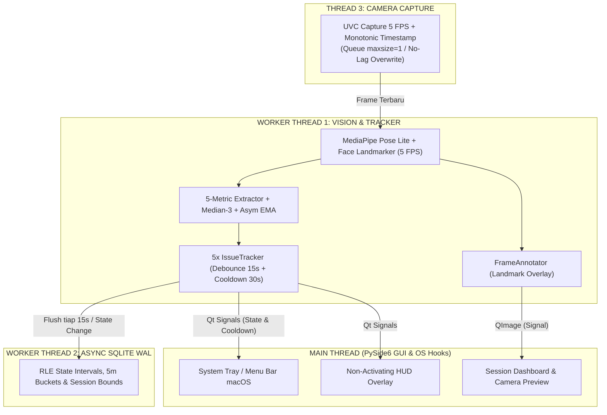

# Bapode (v3.0 Daily-Use Production)

[](https://www.python.org/downloads/)
[](https://wiki.qt.io/Qt_for_Python)
[](https://developers.google.com/mediapipe)
[]()
[](https://github.com/astral-sh/ruff)

> Aplikasi utilitas desktop harian (*daily-use personal utility*) berbasis webcam monokuler yang memantau kepatuhan postur tubuh relatif terhadap referensi personal dan paparan beban statis secara **100% on-device, sadar-privasi, dan non-intrusive**.

---

## 1. Ini Aplikasi Apa?
**Bapode** dirancang untuk para pekerja komputer harian—programmer, penulis, desainer, dan pekerja profesional—yang menghabiskan waktu berjam-jam duduk di depan laptop atau monitor komputer.

Berbeda dari aplikasi pengingat postur konvensional yang sering mengganggu fokus kerja dengan *popup* berisik atau kalkulasi sudut yang tidak realistis, Bapode dibangun di atas prinsip:

1. **Non-Intrusive & Anti-Focus-Stealing:**  
   Aplikasi tinggal dengan tenang di **Menu Bar macOS / System Tray Windows**. Peringatan visual (HUD Overlay) dirancang **tembus-klik (*click-through*)**, **tidak pernah mencuri fokus ketikan (*keyboard focus*)**, dan **otomatis tidak terlihat saat membagikan layar (*screen-sharing safe*)** di Google Meet, Zoom, atau Teams.
2. **Kepatuhan Relatif, Bukan Klinis Absolut:**  
   Aplikasi tidak mendiagnosis penyakit tulang belakang atau memaksakan sudut standar buku kedokteran yang kaku. Sebaliknya, aplikasi mempelajari **posisi duduk tegak ideal pengguna sendiri** melalui kalibrasi 3 detik, kemudian memantau deviasi relatif dari titik referensi tersebut.
3. **Privasi Penuh (100% On-Device):**  
   Seluruh pemrosesan *computer vision* (Google MediaPipe Pose & Face) berjalan lokal di perangkat pengguna. **Tidak ada gambar, video, atau frame webcam yang pernah disimpan ke disk atau dikirim ke internet.**

---

## ⚡ Panduan Cepat Menjalankan di Windows (Quickstart)

Bapode v3.0 telah dioptimalkan secara penuh untuk sistem operasi **Windows 10 & 11** dengan dukungan akselerasi webcam DirectShow, perlindungan privasi rapat via Win32 `SetWindowDisplayAffinity`, dan *sleep/wake event hooks*.

### 1. Setup Lingkungan Otomatis (Pertama Kali)
Cukup jalankan script batch otomatis:
```cmd
setup_windows.bat
```
Script ini akan secara otomatis:
- Membuat *virtual environment* Python (`.venv`) jika belum ada.
- Menginstall seluruh dependensi (`PySide6`, `opencv-python`, `mediapipe`, `numpy`, `pywin32`).
- Mengunduh model Google MediaPipe (`pose_landmarker_lite.task` & `face_landmarker.task`) ke folder `models/`.

### 2. Menjalankan Aplikasi
Pilih salah satu cara termudah:
- **Double-Click:** Klik dua kali file `run.bat` di Windows Explorer.
- **PowerShell:** Jalankan `.\run.ps1`
- **Command Prompt:** Jalankan `run.bat`

```cmd
# Menjalankan dengan antarmuka grafis (Default):
run.bat

# Menjalankan langsung membuka dashboard:
run.bat --show-dashboard

# Menjalankan kalibrasi 3 detik saat start:
run.bat --calibrate
```

---

## 2. Fitur-Fitur Utama

### 🧠 Computer Vision & 5 Metrik Geometris Satu Arah
Memanfaatkan **MediaPipe Pose Landmarker (Lite)** dan **MediaPipe Face Landmarker** pada laju efisien daya $5\text{ FPS}$ ($\Delta t \approx 200\text{ ms}$):
* **HEAD_FORWARD_SCALE ($d_{\text{fhp}}$):** Mengukur kecenderungan kepala maju (*Forward Head Posture*) melalui rasio biokular terhadap lebar bahu dengan kompensasi sudut putar kepala (*yaw*).
* **TORSO_NECK_COMPRESSION ($d_{\text{neck}}$):** Mengukur leher yang melorot/tertekan terhadap garis bahu menggunakan proyeksi ortogonal ($L_{\text{neck-ort}}$) yang kebal terhadap kemiringan bahu (*shoulder roll*).
* **SHOULDER_VERTICAL_DROP ($d_{\text{slump}}$):** Mendeteksi punggung membungkuk (*slouching/slumping*) dengan koreksi perspektif optik $S_w(t) = W_{\text{sh}}(t) / W_{\text{sh,base}}$ agar tidak memicu alarm palsu saat tubuh condong maju secara wajar.
* **GAZE_DOWN_PITCH ($d_{\text{pitch}}$):** Memantau sudut menunduk berlebih ke arah bawah laptop.
* **CORONAL_ASYMMETRY ($d_{\text{tilt}}$):** Mendeteksi kemiringan bahu atau kepala asimetris ke kiri/kanan.

### 🛡️ Filter Sinyal Cerdas & Logika Anti-Nagging
* **Sliding Median-3 & Asymmetric EMA Sadar-$\Delta t$:** Menepis lonjakan *noise* transien sekaligus menjaga latensi peluruhan yang sangat cepat ($\tau_{\text{release}} = 0.3\text{ detik}$) begitu pengguna kembali duduk tegak.
* **One-Way Velocity Gate:** Membedakan gerakan dinamis wajar (mengambil minum, mengetik dinamis) menggunakan deteksi kecepatan normalisasi $v_{\text{norm}}$. Gerbang ini **menahan masuknya pelanggaran baru**, tetapi **tidak pernah menahan hilangnya peringatan** saat pengguna kembali tegak.
* **Debounce 15 Detik & Step-Down Floor:** Pelanggaran harus bertahan terus-menerus selama $15\text{ detik}$ sebelum *overlay* aktif muncul. Saat postur pulih, akumulator durasi dipotong ke lantai dasar $9\text{ detik}$ untuk mencegah peringatan beruntun.
* **Cooldown & Eskalasi Micro-Break:** Cooldown $30\text{ detik}$ antar-peringatan visual. Jika terjadi $\ge 3$ kali pelanggaran dalam $10\text{ menit}$, aplikasi mengeskalasi peringatan menjadi pengingat peregangan *micro-break* ($60\text{ detik}$).

### 🎯 Kalibrasi Personal Terpandu & Setup Drift Detector
* **Kalibrasi 3 Detik (15 Sampel):** Dilengkapi *Plausibility Gate* untuk memastikan pengguna tidak merekam posisi miring sebagai baseline.
* **MAD Noise Floor Adaptif:** Menyesuaikan ambang deteksi secara otomatis sesuai intensitas pencahayaan ruangan (*ambient lighting*).
* **Setup Drift Detector:** Jika posisi kursi dimundurkan atau sudut layar laptop diubah, sistem mendeteksi pergeseran setelah $10\text{ detik}$ dan menyarankan kalibrasi ulang tanpa memicu alarm postur palsu.

### 🖥️ Antarmuka Desktop Modern (PySide6 / Qt6)
* **📷 Pratinjau Kamera Langsung (Live Camera View):** Tab khusus di Dashboard yang menampilkan *feed* webcam pada 5 FPS dengan visualisasi *landmark* sendi bahu (Hijau/Merah), garis mata, retikel wajah, orientasi kepala 3D, serta siluet panduan saat kalibrasi.
* **Non-Activating HUD Overlay:** Peringatan visual halus di tepi layar yang transparan dari klik mouse dan terlindung dari *screen recording / screen sharing* (`NSWindowSharingNone` di macOS & `WDA_EXCLUDEFROMCAPTURE` di Windows).
* **Menu Bar / System Tray:** Ikon lingkaran dinamis (Hijau, Kuning, Merah, Abu-abu) dengan menu kalibrasi ulang, pembuka dashboard, dan *Quick Snooze* ($15 / 30 / 60\text{ menit}$).
* **📊 Dashboard Sesi & Tren Historis:** Pelaporan jujur oklusi (*Reference Adherence* vs *Conservative Bound*) dan tabel telemetri interval $5\text{ menit}$ yang bebas dari efek dilusi periode tegak.
* **⚙️ Live Telemetry Mode (CLI / TUI):** Mode konsol real-time untuk melihat kalkulasi nilai deviasi $\hat{d}_i(t)$, *noise* $\sigma_i(t)$, dan ambang batas $\tau_{\text{enter}} / \tau_{\text{exit}}$ untuk tuning empiris.

---

## 3. Cara Menjalankan

### Kebutuhan Sistem
* **Sistem Operasi:** macOS (Apple Silicon / Intel), Windows 10/11, atau Linux.
* **Python:** Versi $3.11$ atau $3.12$ (disarankan $3.12$).
* **Perangkat:** Kamera webcam (internal laptop atau USB webcam eksternal).

### Instalasi & Setup Lingkungan

```bash
# 1. Clone repositori
git clone https://github.com/Josh682/Bapode.git
cd Bapode

# 2. Buat virtual environment (Python 3.12 disarankan)
python3.12 -m venv .venv
source .venv/bin/activate  # Di Windows: .venv\Scripts\activate

# 3. Instal dependensi
pip install -r requirements.txt
# Atau instal dependensi inti:
pip install numpy PySide6 opencv-python mediapipe pytest pytest-qt ruff mypy
```

### Menjalankan Aplikasi

Tersedia skrip peluncur otomatis `./run.sh` yang mendeteksi virtualenv dan secara otomatis membersihkan flag file macOS:

#### 1. Mode Normal (Latar Belakang di Menu Bar macOS / Tray)
Aplikasi akan aktif memantau postur secara senyap. Ikon lingkaran hijau akan muncul di **Menu Bar kanan atas layar Mac Anda**:
```bash
./run.sh
# Atau:
python src/main.py
```

#### 2. Mode Dashboard Langsung Terbuka
Membuka aplikasi sekaligus langsung menampilkan jendela **Dashboard & Pratinjau Kamera**:
```bash
./run.sh --show-dashboard
```

#### 3. Mode Kalibrasi Cepat
Langsung membuka dialog panduan posisi duduk 3 detik dengan siluet video kamera:
```bash
./run.sh --calibrate
```

#### 4. Mode Live Telemetry / Threshold Tuning (Terminal TUI)
Menampilkan tabel nilai deviasi 5 metrik dan ambang batas secara real-time di terminal:
```bash
./run.sh --calibrate-thresholds
```

#### 5. Uji Webcam Fisik (Smoke Test 10 Detik)
Memvalidasi fungsionalitas kamera UVC, pembacaan 5 FPS, model MediaPipe, dan latensi inferensi tanpa membuka GUI:
```bash
python scripts/smoke_test_webcam.py
```

#### 6. Mode Simulasi (Mock Camera - Tanpa Webcam Fisik)
Menjalankan seluruh pipeline dan GUI menggunakan generator frame sintetis (cocok untuk pengujian CI/CD atau perangkat tanpa kamera):
```bash
./run.sh --mock-camera --show-dashboard
```

---

## 4. Batasan Produk & Desain

Agar ekspektasi pengguna tetap selaras dengan tujuan rancangan sistem:

1. **Bukan Alat Medis / Klinis:**
   - Aplikasi **tidak mengukur sudut ortopedi absolut** (seperti *Craniovertebral Angle* derajat medis dari sinar-X atau goniometer).
   - Metrik yang dihasilkan adalah deviasi proporsional terhadap postur referensi yang direkam saat kalibrasi.
2. **Ketergantungan Geometri Kamera Monokuler:**
   - Sudut kemiringan kamera webcam laptop memengaruhi pembacaan perspektif.
   - Jika pengguna memindahkan laptop, mengubah sudut engsel layar laptop secara signifikan, atau menggeser kursi kerja menjauh/mendekat, sistem akan mendeteksi *Setup Drift* dan meminta kalibrasi ulang singkat ($3\text{ detik}$).
3. **Kondisi Pencahayaan Ekstrem:**
   - Di ruangan yang sangat gelap, kualitas penanda landmark MediaPipe akan berfluktuasi tinggi.
   - Algoritma adaptif *MAD Noise Floor* akan menaikkan ambang toleransi, dan jika kebisingan melampaui batas kemampuan estimasi ($\tau_{\text{cap}}$), aplikasi akan memperingatkan pengguna bahwa pencahayaan kurang memadai.
4. **Oklusi & Batasan Bidang Pandang:**
   - Metrik bahu membutuhkan kedua bahu masuk dalam *frame*. Jika pengguna bersandar sangat dekat ke kamera sehingga bahu terpotong di tepi bawah, status beralih ke `OCCLUDED_LOWER`.
   - Jika pengguna menunduk ekstrem menatap smartphone di pangkuan sehingga wajah menghilang dari kamera, status beralih ke `OCCLUDED_UPPER`.
   - **Periode oklusi tidak pernah dihitung sebagai waktu duduk tegak**; sistem mencatatnya secara jujur dalam metrik *Conservative Adherence Bound*.
5. **Konsumsi Daya Rendah (5 FPS):**
   - Laju pemrosesan sengaja dibatasi pada $5\text{ frame per detik}$ untuk menjamin baterai laptop tidak terkuras cepat dan suhu CPU tetap dingin sepanjang hari.

---

## 5. Arsitektur Multi-Threading

Untuk menjamin antarmuka pengguna tidak pernah *freeze* atau *stutter*, Bapode memisahkan beban kerja ke dalam 4 *thread* terpisah:



* **Thread 3 (Camera Reader):** Mengakuisisi frame UVC dengan antrean ukuran 1 (`queue.Queue(maxsize=1)`) sehingga tidak pernah terjadi lag penumpukan frame lawas saat beban CPU tinggi.
* **Worker Thread 1 (Vision & Tracker):** Menjalankan inferensi model berurutan, mengekstraksi metrik, menghitung deviasi filter EMA, dan memancarkan sinyal status ke GUI murni melalui `QtCore.Signal`.
* **Worker Thread 2 (Database Writer):** Menyimpan interval sesi secara asinkron ke SQLite berformat WAL (`Write-Ahead Logging`) tanpa mengganggu kelancaran GUI atau kamera.
* **Main Thread (GUI):** Bertanggung jawab atas rendering menu System Tray, jendela HUD Overlay anti-fokus, dialog kalibrasi, dan Dashboard.

---

## 6. Konfigurasi Parameter (`config.toml`)

Seluruh parameter sensitivitas, ambang batas deviasi, durasi debounce, dan toleransi kecepatan dapat disesuaikan langsung di file [config.toml](file:///Users/mac/Documents/Developer/Projects/Bapo/config.toml) tanpa mengubah kode program:

```toml
[metrics]
# Ambang batas pemicu pelanggaran default (tau_default_enter)
tau_default_enter = { fhp = 0.080, neck = 0.080, slump = 0.060, pitch = 12.0, tilt = 8.0 }

# Ambang batas pemulihan tegak (tau_exit)
tau_exit = { fhp = 0.040, neck = 0.040, slump = 0.030, pitch = 6.0, tilt = 4.0 }

[motion]
# Ambang batas gerak kuasi-statis (lebar-bahu / detik)
v_thresh = 0.150
# Maksimal durasi penahanan gerbang kecepatan saat bergerak (detik)
freeze_max_s = 3.0

[tracker]
# Durasi ember debounce sebelum alert overlay aktif (detik)
debounce_time_s = 15.0
# Lantai pemotongan akumulator saat postur pulih tegak (detik)
step_down_floor_s = 9.0
# Waktu jeda antar-peringatan visual (detik)
cooldown_duration_s = 30.0
```

---

## 7. Pengujian & Verifikasi Mandiri

Sesuai pedoman rekayasa perangkat lunak di `AGENTS.md`, seluruh modul dilengkapi pengujian komprehensif:

```bash
# 1. Jalankan seluruh unit test & integration test (73 tests)
pytest tests/ -v

# 2. Jalankan linter dan formatter check
ruff check src/ tests/ scripts/
ruff format --check src/ tests/ scripts/

# 3. Jalankan strict type checker
mypy src/
```

Semua pengujian dijalankan dalam mode *headless / offscreen* yang aman untuk integrasi CI/CD.

---

## Lisensi
Proyek ini dilisensikan di bawah lisensi internal / perorangan untuk penggunaan utilitas pribadi. Dilarang mengunggah telemetri atau data pengguna ke server eksternal tanpa izin.
