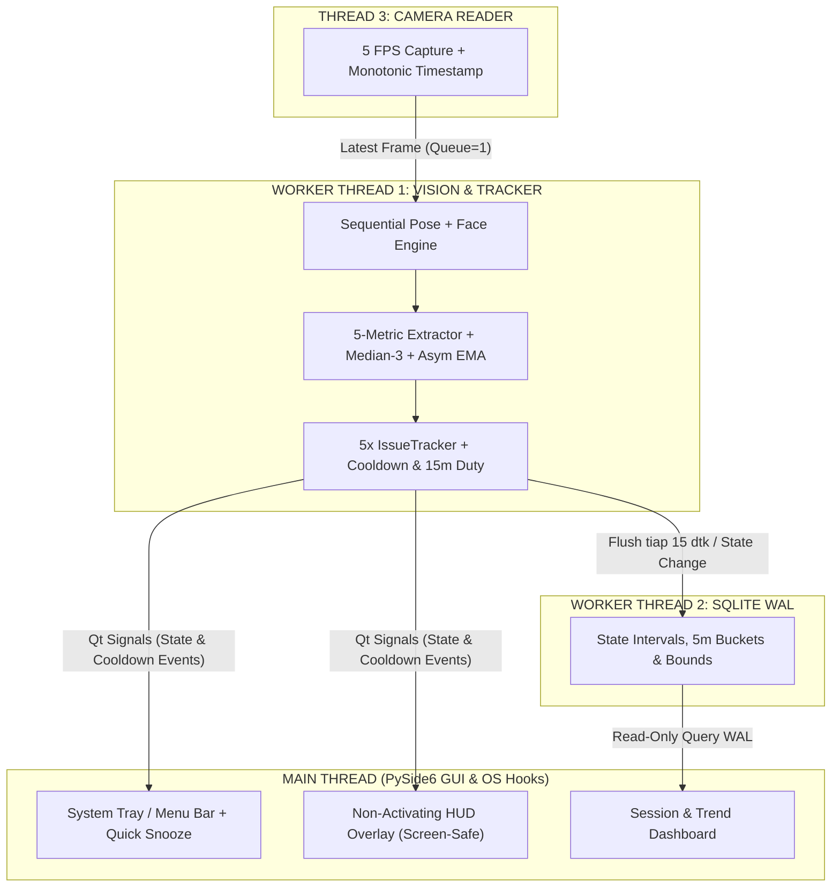

# ARCHITECTURE.md — Arsitektur Thread, State Machine, & Integrasi OS

## 1. Topologi Multi-Threading (3 Worker + 1 Main GUI)
Aplikasi memisahkan akuisisi I/O kamera, inferensi *computer vision*, penulisan *database*, dan antarmuka pengguna ke dalam *thread* terpisah untuk menjamin UI selalu responsif dan laju *sampling* stabil pada $5\text{ FPS}$ ($\Delta t \approx 200\text{ ms}$).

### Keputusan Teknis Arsitektur (ADR)
1. **Mengapa `Queue(maxsize=1)` antara Kamera dan Vision?**
   Mencegah penumpukan *frame* (*buffer lag*) apabila CPU sedang sibuk. Jika *Worker Thread 1* terlambat memproses satu *frame*, *Thread 3* membuang *frame* lama dan menggantinya dengan *frame* terbaru ber-cap waktu `time.monotonic()`.
2. **Mengapa Inferensi Pose & Face Berjalan Sekuensial dalam Satu Thread?**
   Menjalankan dua model MediaPipe secara paralel di *thread* berbeda memicu kontensi *thread-pool* internal XNNPACK/TFLite dan meningkatkan lonjakan termal CPU pada penggunaan harian. Eksekusi berurutan pada $5\text{ FPS}$ memberi anggaran waktu $200\text{ ms}$ per siklus, sedangkan waktu inferensi gabungan `Pose Lite` + `Face` hanya membutuhkan $\approx 15\text{--}35\text{ ms}$ pada CPU modern.

---

## 2. Dekomposisi State 3-Sumbu Ortogonal
Untuk mencegah ledakan kombinasi *state* akibat pencampuran status kamera dan status postur, kondisi sistem dipisahkan menjadi 3 sumbu independen:

### Sumbu 1: `OperatingMode` (Kontrol Sesi & Drift)
- `UNINITIALIZED`: Aplikasi baru dibuka dan belum memiliki profil kalibrasi aktif.
- `CALIBRATING`: Sedang merekam $15\text{ sampel}$ ($3\text{ detik}$) postur referensi.
- `ACTIVE_MONITORING`: Pemantauan aktif berjalan.
- `PAUSED_MANUAL`: Dijeda oleh pengguna melalui *Quick Snooze* ($15/30/60\text{ menit}$).
- `PAUSED_MEETING_AUTO`: Dijeda otomatis karena terdeteksi aplikasi rapat/presentasi *fullscreen*.
- `NEEDS_RECALIBRATION`: Pemantauan ditangguhkan sementara karena terdeteksi perubahan posisi kursi atau sudut engsel layar ($\ge 10\text{ detik}$).

### Sumbu 2: `VisibilityState` (Matriks $2 \times 2$ Wajah $\times$ Bahu)
Hanya dievaluasi ketika `OperatingMode == ACTIVE_MONITORING`:
- `MEASURABLE` (**Wajah Terdeteksi, Bahu Terdeteksi**): Kelima metrik postur dievaluasi penuh.
- `OCCLUDED_LOWER` (**Wajah Terdeteksi, Bahu Hilang**): Bahu keluar dari tepi bawah layar atau tertutup tangan. Evaluasi metrik berbasis bahu ditangguhkan; namun jika rasio lebar mata $W_{\text{eye-corr}} / W_{\text{eye, base}} \gt 1.30$ bertahan $\ge 15\text{ detik}$, sistem memicu peringatan `EXTREME_CLOSE_PROXIMITY`.
- `OCCLUDED_UPPER` (**Wajah Hilang, Bahu Terdeteksi**): Pengguna masih di kursi tetapi wajah gagal dideteksi (misal menunduk sangat curam menatap ponsel di pangkuan, minum, atau wajah tertutup tangan). Dicatat sebagai waktu tidak terukur (`occluded_upper_seconds`).
- `ABSENT` (**Wajah Hilang, Bahu Hilang**): Pengguna meninggalkan meja kerja.

### Sumbu 3: `UIIntrusivenessLevel` (Eskalasi & Anti-Nagging)
- `SILENT_OK`: Semua ember durasi $D_i \lt 7.5\text{ detik}$ (Ikon *Tray* Hijau).
- `AMBIENT_WARN`: Salah satu ember mencapai $\max_i(D_i) \ge 7.5\text{ detik}$ (Ikon *Tray* Kuning, tanpa *overlay* layar).
- `ACTIVE_OVERLAY`: Salah satu isu mencapai $D_i = 15.0\text{ detik}$ dan tidak sedang dalam masa *cooldown* (*Overlay* tepi layar tampil).
- `SUPPRESSED_COOLDOWN`: Status `alert` logis aktif ($D_i = 15.0\text{ detik}$), tetapi *overlay* ditahan karena baru saja tampil $\lt 30\text{ detik}$ yang lalu.
- `MICROBREAK_PROMPT`: Eskalasi khusus jika terjadi $\ge 3$ kali *alert* dalam jendela $10\text{ menit}$ atau *duty cycle* pelanggaran dalam $15\text{ menit}$ melewati ambang batas.

---

## 3. Ketahanan Sistem Operasi & Siklus Hidup Data
1. **Flush Berkala & Transisi State:**
   *Worker Thread 2* melakukan *commit* transaksi ke SQLite WAL setiap **$15\text{ detik}$**, setiap terjadi perpindahan `VisibilityState` atau `UIIntrusivenessLevel`, serta saat aplikasi ditutup.
2. **Penanganan Sleep / Wake OS:**
   - **macOS:** Mendengarkan `NSWorkspaceWillSleepNotification` dan `NSWorkspaceDidWakeNotification` melalui `PyObjC`.
   - **Windows:** Menangkap pesan `WM_POWERBROADCAST` (`PBT_APMSUSPEND` dan `PBT_APMRESUMEAUTOMATIC`) melalui `winEventFilter` di PySide6.
   - Saat sinyal *sleep* diterima, sistem langsung menutup interval aktif di SQLite, melepas *handle* kamera UVC, dan membekukan *timer* sesi agar waktu tidur laptop tidak terhitung sebagai durasi postur.